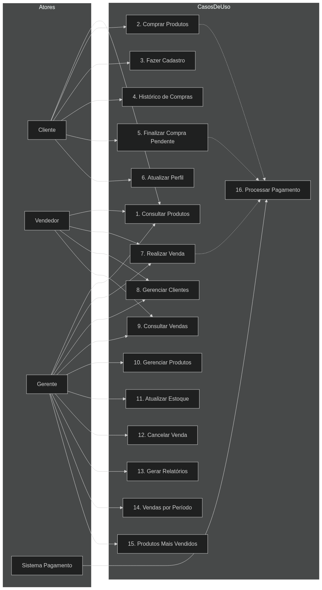
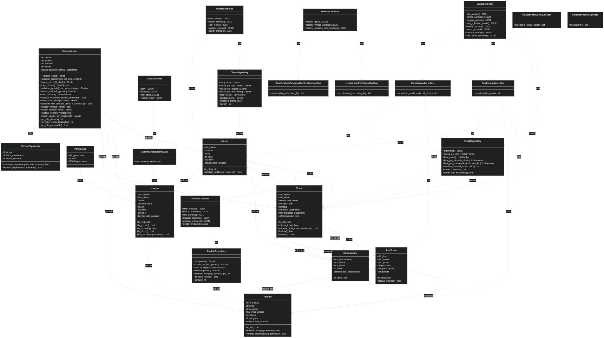

<div align="center">

# **Playtime**
### Sistema para Lojas de Brinquedos
---

## **Sobre o Projeto**

O **Playtime** é um sistema web completo para gerenciamento de lojas de brinquedos, desenvolvido como projeto da disciplina **Programação para Web**. O sistema permite que clientes comprem produtos, vendedores realizem vendas e gerentes controlem estoque, clientes e gerem relatórios.

O projeto é dividido em **back-end** (Python + Flask + PostgreSQL) e **front-end** (Next.js + TypeScript + Tailwind CSS), seguindo princípios de **DDD (Domain-Driven Design)**, **Repository Pattern** e **Arquitetura em Camadas**.

---

## **Atores do Sistema**

| Ator | Funcionalidades |
|------|-----------------|
| **Cliente** | • Consultar produtos<br>• Realizar cadastro<br>• Comprar produtos<br>• Visualizar histórico de compras<br>• Finalizar compras pendentes<br>• Atualizar perfil |
| **Vendedor** | • Gerenciar cadastro de clientes<br>• Consultar produtos<br>• Realizar vendas<br>• Consultar vendas realizadas |
| **Gerente** | • Atualizar estoque<br>• Gerenciar produtos (CRUD)<br>• Gerenciar clientes (CRUD)<br>• Gerar relatórios<br>• Cancelar vendas pendentes |
| **Sistema de Pagamento** | • Processamento externo de transações financeiras (simulado) |

---

## **Casos de Uso**

| # | Caso de Uso | Atores | 
|---|-------------|--------|
| 1 | Consultar produto | Cliente, Vendedor, Gerente |
| 2 | Comprar produto | Cliente | 
| 3 | Fazer cadastro | Cliente | 
| 4 | Histórico de compras | Cliente | 
| 5 | Finalizar compra pendente | Cliente | 
| 6 | Atualizar perfil | Cliente | 
| 7 | Realizar venda | Vendedor, Gerente | 
| 8 | Gerenciar clientes | Gerente | 
| 9 | Consultar vendas | Vendedor, Gerente | 
| 10 | Gerenciar produtos | Gerente | 
| 11 | Atualizar estoque | Gerente | 
| 12 | Cancelar venda | Gerente | 
| 13 | Gerar relatórios | Gerente | 
| 14 | Vendas por período | Gerente | 
| 15 | Produtos mais vendidos | Gerente | 
| 16 | Processar pagamento | Sistema Pagamento | 



---

## **Diagrama de Classes (Back-end)**



### Entidades principais:

| Entidade | Descrição |
|----------|-----------|
| **Cliente** | Dados pessoais do cliente (nome, CPF, email, ativo) |
| **Usuario** | Autenticação e perfil (email, senha_hash, perfil, ativo, nome) |
| **Produto** | Produtos da loja (nome, descrição, preço, estoque, categoria) |
| **Venda** | Vendas realizadas (cliente, data, valor, status, método pagamento) |
| **ItemVenda** | Itens de cada venda (produto, quantidade, preço unitário, subtotal) |
| **Cancelamento** | Registro de vendas canceladas (motivo, data) |
| **Permissoes** | Controle de acesso RBAC (perfil, permissões em JSON) |

### Relacionamentos:

- **Clientes** (1) ― (N) **Vendas**: Um cliente pode ter várias vendas
- **Clientes** (1) ― (1) **Usuarios**: Cada cliente tem um usuário associado
- **Vendas** (1) ― (N) **ItensVenda**: Uma venda tem vários itens
- **Produtos** (1) ― (N) **ItensVenda**: Um produto pode estar em vários itens
- **Vendas** (1) ― (1) **Cancelamentos**: Uma venda pode ter um cancelamento

---

## **Tecnologias Utilizadas**

<div align="center">

| Categoria | Tecnologias |
|-----------|-------------|
| **Front-end** | Next.js · TypeScript · JavaScript · Tailwind CSS |
| **Back-end** | Python · Flask · JWT · bcrypt |
| **Banco de Dados** | PostgreSQL (Neon.tech) |
| **Versionamento** | Git · GitHub |
| **Prototipação** | Figma |
| **Arquitetura** | DDD · Repository Pattern · Arquitetura em Camadas |
| **Qualidade de Código** | ESLint · PostCSS · Autoprefixer |

</div>

---

## **Autenticação e Segurança**

O sistema utiliza **JWT (JSON Web Token)** para autenticação e **RBAC (Role-Based Access Control)** para controle de permissões.

### Perfis e Permissões

| Perfil | Permissões |
|--------|------------|
| **Cliente** | • Consultar produtos<br>• Comprar produtos<br>• Ver próprias compras<br>• Atualizar perfil |
| **Vendedor** | • Consultar produtos<br>• Realizar vendas<br>• Consultar vendas<br>• Gerenciar clientes |
| **Gerente** | • Todas as permissões acima<br>• Gerenciar produtos (CRUD)<br>• Atualizar estoque<br>• Cancelar vendas<br>• Gerar relatórios |

---

## **Endpoints da API**

### Autenticação

| Método | Endpoint | Descrição | Autenticação |
|--------|----------|-----------|--------------|
| POST | `/api/login` | Login e geração de token JWT | ❌ |
| POST | `/api/registrar` | Registrar novo usuário (cliente) | ❌ |
| GET | `/api/me/perfil` | Buscar perfil do usuário logado | ✅ |
| POST | `/api/verificar-email` | Verificar se email já está cadastrado | ❌ |

### Clientes

| Método | Endpoint | Descrição | Autenticação |
|--------|----------|-----------|--------------|
| GET | `/clientes` | Listar todos os clientes | ✅ (Vendedor/Gerente) |
| GET | `/clientes/{id}` | Buscar cliente por ID | ✅ |
| POST | `/clientes` | Cadastrar novo cliente | ❌ |
| PUT | `/clientes/{id}` | Atualizar cliente | ✅ (Vendedor/Gerente) |
| DELETE | `/clientes/{id}` | Deletar cliente | ✅ (Gerente) |

### Produtos

| Método | Endpoint | Descrição | Autenticação |
|--------|----------|-----------|--------------|
| GET | `/produtos` | Listar todos os produtos | ✅ |
| GET | `/produtos/{id}` | Buscar produto por ID | ✅ |
| POST | `/produtos` | Cadastrar novo produto | ✅ (Gerente) |
| PUT | `/produtos/{id}` | Atualizar produto | ✅ (Gerente) |
| PATCH | `/produtos/{id}/estoque` | Atualizar estoque | ✅ (Gerente) |
| DELETE | `/produtos/{id}` | Deletar produto | ✅ (Gerente) |

### Vendas e Compras

| Método | Endpoint | Descrição | Autenticação |
|--------|----------|-----------|--------------|
| GET | `/vendas` | Listar todas as vendas | ✅ (Vendedor/Gerente) |
| GET | `/vendas/{id}` | Buscar venda por ID | ✅ |
| GET | `/compras/cliente` | Listar compras do cliente logado | ✅ (Cliente) |
| POST | `/vendas/comprar` | Cliente comprar produto | ✅ (Cliente) |
| POST | `/vendas/direta` | Realizar venda (cria e finaliza) | ✅ (Vendedor/Gerente) |
| POST | `/vendas/{id}/finalizar` | Finalizar venda | ✅ |
| POST | `/vendas/{id}/cancelar` | Cancelar venda | ✅ (Gerente) |
| POST | `/vendas/pendente` | Criar venda pendente | ✅ |
| POST | `/vendas/{id}/itens` | Adicionar item à venda | ✅ |
| GET | `/vendas/{id}/itens` | Listar itens da venda | ✅ |
| DELETE | `/vendas/{id}/itens/{produto_id}` | Remover item da venda | ✅ |

### Relatórios

| Método | Endpoint | Descrição | Autenticação |
|--------|----------|-----------|--------------|
| GET | `/api/relatorios/geral` | Relatório geral do sistema | ✅ (Gerente) |
| GET | `/api/relatorios/vendas-periodo` | Vendas por período | ✅ (Gerente) |
| GET | `/api/relatorios/produtos-mais-vendidos` | Produtos mais vendidos | ✅ (Gerente) |

---

## **Páginas Implementadas (Front-end)**

| Rota | Página | Descrição | Perfil |
|------|--------|-----------|--------|
| `/login` | Login | Acesso para usuários | Público |
| `/menu` | Menu Principal | Navegação entre funcionalidades | Todos |
| `/pesquisa` | Pesquisar Produtos | Busca e visualização de produtos | Todos |
| `/compra` | Finalizar Compra | Carrinho e simulação de compra | Cliente |
| `/estoque` | Gestão de Estoque | Gerente atualiza quantidades | Gerente |
| `/produto` | Gerenciar Produtos | CRUD completo de produtos | Gerente |
| `/venda` | Realizar Venda | Vendedor realiza venda para cliente | Vendedor/Gerente |

---

## **Banco de Dados**

### Modelo Relacional

- **clientes**: Armazena dados pessoais dos clientes (id_cliente, nome, cpf, email, ativo, data_cadastro)
- **usuarios**: Armazena credenciais e perfil dos usuários (id_usuario, id_cliente, email, senha_hash, perfil, ativo, nome, data_cadastro)
- **produtos**: Armazena o catálogo de produtos (id_produto, nome, descricao, preco_unitario, estoque, categoria, data_cadastro)
- **vendas**: Armazena as transações de venda (id_venda, id_cliente, data_venda, valor_total, status, metodo_pagamento, id_transacao_pagamento)
- **itens_venda**: Armazena os itens de cada venda (id_item, id_venda, id_produto, quantidade, preco_unitario, subtotal)
- **cancelamentos**: Registra vendas canceladas (id_cancelamento, id_venda, id_cliente, motivo, data_cancelamento)
- **permissoes**: Controla permissões por perfil (id_permissao, perfil, permissoes)

### Relacionamentos entre tabelas

- **clientes** (1) ― (N) **vendas**: Um cliente pode ter várias vendas
- **clientes** (1) ― (1) **usuarios**: Cada cliente tem um usuário associado
- **vendas** (1) ― (N) **itens_venda**: Uma venda tem vários itens
- **produtos** (1) ― (N) **itens_venda**: Um produto pode estar em vários itens
- **vendas** (1) ― (1) **cancelamentos**: Uma venda pode ter um cancelamento

---

## **Estrutura do Projeto**

```
Playtime/
├── back-end/                  # API Flask
│   ├── app.py
│   ├── requirements.txt
│   └── ...
├── front-end/                 # Aplicação Next.js
│   ├── src/
│   │   ├── app/               # Rotas (App Router)
│   │   ├── components/        # Componentes reutilizáveis
│   │   ├── contexts/          # Contextos React (ex: Auth)
│   │   ├── services/          # Chamadas à API
│   │   ├── styles/            # Estilos globais
│   │   └── types/             # Tipagens TypeScript
│   ├── public/                # Arquivos estáticos
│   ├── eslint.config.mjs      # Configuração do ESLint
│   ├── next.config.ts         # Configuração do Next.js
│   ├── postcss.config.mjs     # Configuração do PostCSS
│   ├── tailwind.config.js     # Configuração do Tailwind CSS
│   ├── tsconfig.json          # Configuração do TypeScript
│   └── package.json
└── docs/                      # Diagramas e documentação
```

### Aliases TypeScript (`tsconfig.json`)

| Alias | Caminho |
|-------|---------|
| `@/*` | `./src/*` |
| `@components/*` | `./src/components/*` |
| `@contexts/*` | `./src/contexts/*` |
| `@services/*` | `./src/services/*` |
| `@styles/*` | `./src/styles/*` |
| `@types/*` | `./src/types/*` |

---

## **Tema Tailwind (`tailwind.config.js`)**

Cores customizadas definidas no projeto:

| Token | Cor | Uso |
|-------|-----|-----|
| `primary` | `#4f46e5` | Cor principal da marca |
| `primary-dark` | `#4338ca` | Variação escura |
| `primary-light` | `#818cf8` | Variação clara |
| `primary-bg` | `#eef2ff` | Fundo suave |
| `success` | `#22c55e` | Confirmações |
| `danger` | `#ef4444` | Erros/cancelamentos |
| `warning` | `#f59e0b` | Alertas |

---

## **Qualidade de Código (Front-end)**

O projeto usa **ESLint** com as configurações oficiais do Next.js:

- `eslint-config-next/core-web-vitals` → boas práticas de performance e acessibilidade
- `eslint-config-next/typescript` → regras específicas para TypeScript
- Ignora automaticamente: `.next/**`, `out/**`, `build/**`, `next-env.d.ts`

E **PostCSS** com **Tailwind CSS** e **Autoprefixer** para compatibilidade entre navegadores.

---

## **Como Executar o Projeto**

### Pré-requisitos

- Python 3.9+
- Node.js 18+
- Conta no [Neon.tech](https://neon.tech) (PostgreSQL) ou PostgreSQL local

### Back-end

```bash
# 1. Clone o repositório
git clone https://github.com/ahclara/Playtime.git
cd Playtime/back-end

# 2. Crie e ative um ambiente virtual (recomendado)
python -m venv venv
source venv/bin/activate      # Linux/macOS
# venv\Scripts\activate       # Windows

# 3. Instale as dependências
pip install -r requirements.txt

# 3. Configure o banco e a chave JWT
cp .env.example .env
# Edite .env e informe DATABASE_URL e uma SECRET_KEY aleatória

# 4. Execute o servidor
python app.py
```

### Front-end

```bash
cd ../playtime
npm install
npm run dev
```

O front-end estará disponível em `http://localhost:3000` e o back-end em `http://localhost:5000` (por padrão).

---

## **Scripts Disponíveis (Front-end)**

| Script | Descrição |
|--------|-----------|
| `npm run dev` | Inicia o servidor de desenvolvimento |
| `npm run build` | Gera build de produção |
| `npm start` | Inicia o servidor em modo produção |
| `npm run lint` | Executa o ESLint |

---

## 👥 **Equipe**

| Nome | Responsabilidade |
|------|------------------|
| Eduarda Cecília, Thais Maria, Antônio José | Back-end · Banco de Dados | 
| Ana Clara, Selton | Front-end · Design |

---
```
